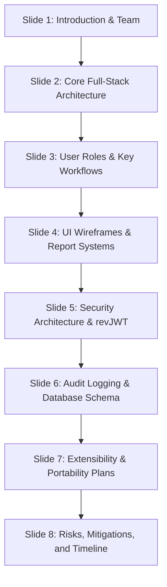

# Proposal Presentation — MediFlow
**Project Title**: *MediFlow — Integrated Pharmacy Operations, Automated Inventory Ledger & Algorithmic Drug Interaction Control System*  
**Presentation Date**: 24/07/2026  
**Presentation Time**: 10 minutes (6-minute presentation + 4-minute Q&A)  
**Team size**: 2 members  

---

## Slides Structure & Technical Specifications



---

### Slide 1: Introduction & Project Scope

#### Slide Content
*   **Project Title**: **MediFlow** — Integrated Pharmacy Operations, Automated Inventory Ledger & Algorithmic Drug Interaction Control System
*   **Team Members**:
    1.  **[Member 1 Name / Initials]** (Index: `[Index 1]`) — *Project Lead & Backend Engineer*
        *   Responsibilities: Database design, Prisma ORM setups, Express REST API routing, JWT auth & revocation mechanism, audit trail implementation, and financial/sales PDF & CSV report engines.
    2.  **[Member 2 Name / Initials]** (Index: `[Index 2]`) — *Frontend & Full-Stack Engineer*
        *   Responsibilities: React + TypeScript client structure, Axios interceptors, digital prescription upload pipelines, payment & pickup PIN interface, real-time DDI alerting system, and neural network model training.
*   **Stakeholders**:
    *   *Primary*: Pharmacists (dispensing and verification), Cashiers (payment and verification), and Administrators (financial auditing).
    *   *Secondary*: Patients (uploads, payment notifications, pickup PIN verification) and Prescribers (medical system inputs).

#### Speaker Notes (Member 1)
> "Good morning, everyone. We are here to present **MediFlow**, a full-stack pharmacy management prototype designed to solve critical errors in dispensing workflow, inventory allocation, and drug safety. 
> I am [Your Name], the Project Lead and Backend Engineer, and my teammate [Partner's Name] is our Frontend and Full-Stack Engineer. 
> Our system targets five key stakeholder groups, starting with pharmacists who verify prescriptions and cashiers who process payments, up to patients who require a frictionless, secure way to submit orders and collect their medications safely."

---

### Slide 2: Core Full-Stack Architecture

#### Slide Content
*   **Relational Database (RDBMS)**: **PostgreSQL** (via **Prisma ORM**)
    *   *Rationale*: Ensures ACID compliance for strict ledger accounting. Uses serializable transactions for inventory adjustments to prevent double-allocation/race conditions under concurrent load. Native support for indexed JSON metadata in logs.
*   **REST API Backend**: **Node.js + Express**
    *   *Rationale*: Async event loop processes high volumes of concurrent I/O requests. Thin controller layers coupled with service-based transactional logic maintain clean modular separation.
*   **SPA Frontend Framework**: **React + TypeScript** (built with **Vite**)
    *   *Rationale*: Strongly-typed states eliminate client-side crash vectors. Decoupled architecture separates content delivery (CDN-level static assets) from processing units.
*   **Deployment Mapping**:
    *   *Production Node.js Backend*: Render / AWS EC2
    *   *Production PostgreSQL*: Supabase / AWS RDS
    *   *Production SPA Client*: Vercel / Cloudflare CDN

#### Speaker Notes (Member 1)
> "Let's dive into the core architecture. We chose a decoupled, full-stack structure. 
> For our database, we selected PostgreSQL, managed via Prisma ORM. PostgreSQL is critical because pharmacy operations require strict transactional integrity—you cannot have two checkouts consuming the same inventory batch simultaneously. Prisma enforces type-safe queries and manages automated SQL parameters, preventing SQL injection out-of-the-box.
> On the server side, Node.js and Express handle the asynchronous rest layer, keeping routers thin and pushing all business rules into robust services. 
> Our frontend is a Single Page Application built on React, TypeScript, and Vite, which allows us to compile optimized static assets that can be distributed globally via CDNs, while communicating with our API server through JWT-secured endpoints."

---

### Slide 3: Functionality & Key Workflows

#### Slide Content
*   **User Roles & System Actions**:
    *   **Admin**: System parameters, staff provisioning, read/write access to security audit trails.
    *   **Pharmacist**: Prescription auditing, clinical drug lookup, stock intake, DDI override execution.
    *   **Cashier**: Queue monitoring, cash/card processing, secure pickup PIN verification.
    *   **Patient**: Self-registration, digital prescription upload, order status & pickup PIN retrieval.
*   **Core Workflows**:
    1.  *Digital Prescription Upload*: Patient uploads image -> pharmacist reviews availability -> generates estimated invoice -> patient receives pickup code.
    2.  *Clinical Verification & DDI Check*: System analyzes active generic drug concepts against RxNorm/DDInter -> alerts pharmacist of MAJOR/MODERATE interactions -> pharmacist overrides with medical justification or modifies items.
    3.  *Dispensing & FIFO Batch Allocation*: System scans inventory -> automatically deducts stock using FIFO (First-In, First-Out) or FEFO (First-Expired, First-Out) rules -> locks batch -> creates cashier payment request and hashes a 4-digit pickup PIN.

#### Speaker Notes (Member 2)
> "Thank you. I am [Your Name], and I will cover the system functionality. MediFlow is built around four specific roles. 
> Rather than a simple CRUD application, we modeled real-world pharmacy operations. Let's look at the core workflows.
> When a patient uploads a prescription, it initiates a preparation request. The pharmacist reviews the image, confirms what is in stock, and maps the products. 
> When the pharmacist verifies the prescription, the system automatically checks for Drug-Drug Interactions using standard RxNorm concepts and the clinical DDInter dataset. If a MAJOR interaction is found, the system blocks progress until a medical justification is recorded.
> Once cleared, the dispensing engine automatically allocates inventory down to the specific batch number using First-In-First-Out (FIFO) rules, which guarantees that older stock is cleared first. The system then locks the inventory and generates a unique, hashed pickup PIN for the cashier phase."

---

### Slide 4: UI Wireframes & Report System

#### Slide Content
*   **UI Wireframe Concept: Pharmacist Workspace**
    ```
    ┌────────────────────────────────────────────────────────┐
    │  Prescription Verification System                      │
    ├────────────────────────────────────────────────────────┤
    │  Patient: John Doe (P-10023)    Date: 2026-07-20       │
    │  [Prescription Image Attachment Preview]               │
    ├────────────────────────────────────────────────────────┤
    │  Active Medications & Dose Details                     │
    │  1. Metformin 500mg (Oral) - BID ──────── [✔ OK]       │
    │  2. Sildenafil 50mg (Oral)  - QD  ── [⚠ MAJOR DDI]    │
    │     ► Alert: DDI with Nitroglycerin.                   │
    │     [ Override Action ] Reason: [ Patient aware  ]     │
    ├────────────────────────────────────────────────────────┤
    │  [ Reject Prescription ]      [ Verify & Allocate ]    │
    └────────────────────────────────────────────────────────┘
    ```
*   **Daily Sales Report (PDF/CSV)**:
    *   Tracks: Invoice #, Patient ID, Gross Sales, Allocated Discounts, Net Revenue, FIFO acquisition costs, and Net profit margin.
*   **Monthly Inventory Report (PDF/CSV)**:
    *   Tracks: SKU, Opening Stock, Stock Received, Dispensed Quantities, Adjustments, Closing Stock, Reorder thresholds, and Stock Valuation.

#### Speaker Notes (Member 2)
> "Here are the layout concepts of our primary workspaces. The pharmacist workspace is split to show the digital prescription image alongside the data entry forms. 
> As items are added, clinical alerts pop up inline. For example, if a patient is prescribed Sildenafil while taking Nitroglycerin, the system displays a MAJOR interaction warning.
> For deliverables, our reporting system is built to output in both PDF and CSV formats.
> The Daily Sales Report uses FIFO acquisition costs to calculate true Net Profit and margins. 
> The Monthly Inventory Report functions as a ledger, detailing every single physical stock movement—opening stock, stock received, dispensed, adjusted, and closing stock value. This is critical for tax auditing and stock shrinkage detection."

---

### Slide 5: Security Architecture & Revocable JWTs

#### Slide Content
*   **Data Integrity & Transport**:
    *   Password storage: Hashed via **bcrypt** with a work factor of 12.
    *   API protection: Strict CORS whitelisting, HTTP-only cookie potential, and parameterized query execution via Prisma ORM (eliminating SQL injections).
*   **Revocable JWT Authentication (revJWT)**:
    ```
    User Client            Express Middleware           PostgreSQL DB
        │                           │                          │
        ├──── JWT (version: 1) ────>┤                          │
        │                           ├──── Check tokenVersion ─>┤ (returns: 1)
        │                           │     [✔ Session Allowed]  │
        │                           │                          │
        │      (User logs out / password resets: tokenVersion increments to 2)
        │                           │                          │
        ├──── JWT (version: 1) ────>┤                          │
        │                           ├──── Check tokenVersion ─>┤ (returns: 2)
        │                           │     [✘ 401 Session Revoked]
    ```

#### Speaker Notes (Member 1)
> "Now let's discuss security, which is a major focus of our design. 
> To protect credentials, we use bcrypt hashing with 12 salt rounds. 
> To protect the API layer, we developed a revocable JWT scheme. Standard JWTs are stateless and cannot be easily cancelled before they expire, which is a significant security risk if a laptop is stolen. 
> In MediFlow, when a JWT is issued, we embed a token version number. On every single request, our auth middleware checks this version against the user’s record in the database. 
> If an administrator locks an account, or if the user resets their password or logs out, the database version increments. Immediately, the old token becomes invalid, terminating all active sessions globally in under a second."

---

### Slide 6: Logging, Auditing & Database Design

#### Slide Content
*   **Structured Auditing Schema (`AuditLog`)**:
    *   *Fields*: `id`, `userId`, `action` (e.g. `STOCK_ADJUSTED`), `entityType` (e.g. `INVENTORY_BATCH`), `entityId`, `details` (JSON payload), `success` (Boolean), `ipAddress`, `requestId` (UUID tracing), `method`, `path`, `createdAt`.
*   **Audit Logic & Data Flow**:
    *   All system write/delete operations are automatically recorded.
    *   *Self-Service Filtering*: Successful client-side read actions by `PATIENT` roles are ignored to prevent database bloating, while all failed attempts and all administrative/clinical operations are auditable.
*   **Retention Policy**:
    *   Logs can be soft-deleted (`deletedAt` flag).
    *   A background job executes `purgeExpiredTrash` daily, automatically hard-deleting logs marked as trash for more than 30 days.

#### Speaker Notes (Member 1)
> "Logging is another core architectural pillar. We designed a custom, structured audit logging table in our database. 
> Rather than writing text files, we capture rich JSON data, including the user, action, target entity type, success status, IP address, and a unique request ID.
> To prevent database bloating, our audit engine uses intelligent filtering: successful patient lookups are excluded, but clinical changes, billing events, and failed patient requests are always logged. 
> Administrators can soft-delete audit records, but the system maintains a strict 30-day trash retention policy. A background job automatically purges trash files once they cross the 30-day boundary, ensuring compliance with standard data protection rules while keeping the database size optimized."

---

### Slide 7: Extensibility & Portability Plans

#### Slide Content
*   **Extensibility Framework**:
    *   *Self-Documenting API*: Express routing is fully documented via Swagger and conforms to the OpenAPI specification.
    *   *Standard Vocabularies*: The database tracks clinical reference standards (RxNorm CUIs, PubChem CIDs, and SMILES chemical formulas), allowing quick integration with external Electronic Health Records (EHR) and drug concept registries.
*   **System Portability**:
    *   *Database Portability*: By abstraction through Prisma, the RDBMS backend can switch from PostgreSQL to Microsoft SQL Server, MySQL, or Oracle by swapping the environment connection string and running schema sync.
    *   *Decoupled SPA Hosting*: The React bundle is fully compiled. The static assets can run on any web server (Apache, Nginx, IIS) or cloud storage bucket (AWS S3) without backend modifications.

#### Speaker Notes (Member 2)
> "We structured MediFlow with extensibility and portability in mind from day one. 
> To support future integrations, our entire REST API is mapped using the OpenAPI specification. External systems like hospital EHRs or insurance portals can consume our endpoints securely. 
> Furthermore, we store standard RxNorm Concept Unique Identifiers (CUIs) and PubChem compound IDs in our medicine table, allowing automatic sync with federal drug reference databases.
> For portability, because we use Prisma ORM, we are not locked into PostgreSQL. Swapping to MySQL, Oracle, or SQL Server is as simple as updating a single environment variable and running the migration tool. 
> The frontend can be built and deployed to any server or CDN, ensuring we can migrate the hosting infrastructure without code refactoring."

---

### Slide 8: Risks, Mitigations & Project Timeline

#### Slide Content
*   **Identified Risks & Technical Mitigations**:
    1.  *Race Conditions in Inventory*: Simultaneous checkout/dispensing events could double-sell a single batch.
        *   *Mitigation*: Isolation level is set to `SERIALIZABLE` in PostgreSQL for dispensing transactions, paired with automatic transaction retries on serialization failure.
    2.  *DDI Alert Fatigue/Accuracy*: Frequent minor alerts cause pharmacists to ignore warning windows.
        *   *Mitigation*: Multi-tier classification (MAJOR, MODERATE, MINOR). MAJOR locks checkout; minor alerts are non-intrusive. Clear visual disclaimer is displayed.
*   **Timeline Roadmap**:
    ```
    [June 2026] ──► Repository Setup & Database Schema Finalization (Done)
    [July 2026] ──► Authentication, DDI Datasets, and Core REST APIs (Done)
    [July 24]   ──► Proposal Presentation & Technical Validation (Milestone)
    [Aug 2026]  ──► Reporting engine, Frontend UI Completion & E2E Testing
    [Sept 2026] ──► Final Deployment & User Acceptance Sign-off
    ```

#### Speaker Notes (Member 2)
> "Finally, let's address our risk matrix and project timeline. 
> Our main technical risk is database race conditions. If two cashiers sell the same medicine box at the same time, it could lead to stock discrepancies. We mitigated this by wrapping our billing actions in PostgreSQL serializable transactions, which reject concurrent edits and execute automated retries.
> We also planned for DDI alert fatigue by classifying warnings into Major, Moderate, and Minor severities, ensuring pharmacists only face interruption blocks for critical events.
> Our timeline shows we completed Phase 1 database design and Phase 2 backend REST engines on schedule. Following today's presentation, we will proceed into Phase 3, connecting our reporting generators and polishing the dashboard interfaces ahead of our final deployment in September.
> Thank you, and we welcome any questions you may have."

---

## Technical Q&A Preparation Guide

This guide compiles potential questions from examiners and highly technical, project-specific answers you can deliver during the Q&A segment.

### 1. Database & Transactions
*   **Question**: *Why did you choose PostgreSQL over MySQL? How does your system handle inventory race conditions if two pharmacists dispense the same batch at the same instant?*
*   **Answer**: 
    > "We chose PostgreSQL because of its robust transaction isolation model and rich JSON index support. To prevent double-allocation or stock race conditions, our dispensing logic runs inside a `SERIALIZABLE` transaction isolation level. If two requests attempt to allocate stock from the same inventory batch simultaneously, PostgreSQL detects the serialization conflict and rolls back one of the transactions. Our service layer includes an automatic retry handler that catches serialization errors, fetches the refreshed stock level, and runs the allocation check again, avoiding crashes while preserving data integrity."

### 2. JWT Revocation (revJWT)
*   **Question**: *You mentioned your JWT tokens are stateless, yet you claim they are revocable. Doesn't validating a version number on every request require database access, defeating the purpose of a stateless JWT?*
*   **Answer**:
    > "Stateless JWTs suffer from the inability to be invalidated before expiry. To solve this without maintaining a memory-heavy blacklist database (like Redis), we introduced a `tokenVersion` check. Although it performs a database query on authenticated requests, this read is an indexed primary key lookup on the `User` table, which is highly optimized by PostgreSQL. This trade-off is highly acceptable in a security-first clinical application, guaranteeing that password resets, account locking, or logouts globally terminate active sessions immediately rather than waiting for token expiration."

### 3. Drug-Drug Interactions (DDI)
*   **Question**: *How is the DDI predictive system trained, and what is your backup when the model fails to predict an interaction?*
*   **Answer**:
    > "The system uses a hybrid model. The first line of defense is a curated, deterministic clinical dataset (imported from DDInter) that links drug concepts by active ingredients. This uses direct key-value mapping and has 100% accuracy for known pairs. The second line of defense is our optional neural classification model trained on PubChem compound structures (SMILES). The predictive model only acts as an auxiliary researcher warning. A missing alert never indicates safety, and our UI displays a mandatory disclaimer highlighting that clinical accountability rests with the pharmacist."

### 4. Logging & Privacy
*   **Question**: *Why do you filter out patient read logs but keep patient failures? Is this a security risk?*
*   **Answer**:
    > "Successful patient read requests—such as refreshing their dashboard to check order status—occur with high frequency and contain no state changes. Logging these would bloat the `audit_logs` table, slowing down administrative indexing. However, failed patient requests (e.g. 401 unauthorized access, invalid PIN entries) represent anomalous behaviors that could indicate credential stuffing or session attacks, so they are logged to allow administrators to monitor security threats. Personal Identifiable Information (PII) like raw passwords is never stored in the logs."

### 5. Report Operations (FIFO Costing)
*   **Question**: *How is Net Profit calculated in the daily report? How do you know the cost of the drug when prices fluctuate?*
*   **Answer**:
    > "MediFlow manages inventory at the batch level. Each batch has an explicit purchase price and expiry date. When a prescription is dispensed, our FIFO engine allocates stock starting from the oldest available batch. The daily report engine reads the specific `batchId` associated with each `SaleItem`, pulls the historical purchase price from that batch record, and aggregates it as the cost of goods sold (COGS). Net Profit is then calculated as Net Revenue minus the exact FIFO COGS, rather than using an averaged or estimated product cost."
